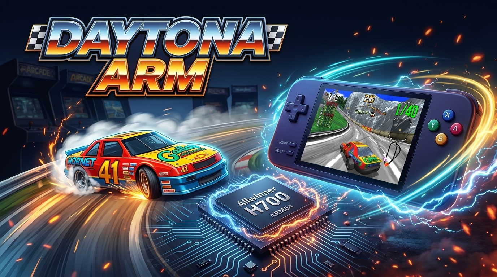

<p align="center">
  
</p>

# DaytonaArm — Daytona USA ARM64 / Anbernic RG34XX Port

[](https://github.com/DanimanX/DaytonaArm/actions/workflows/build-arm64.yml)

An **ARM64 (AArch64) & OpenGL ES 2.0** handheld port of [daytona-arcade-recomp](https://github.com/alphanu1/daytona-arcade-recomp) (static recompilation of **Daytona USA** — Sega Model 2, supporting both **Deluxe '93** (`daytona93`) and **Revision A 1994** (`daytona`)), engineered for the **Anbernic RG34XX** (**Allwinner H700** / Mali-G31 MP2, 720×480 3:2 GBA form factor) and compatible Linux **PortMaster** handhelds.

Following the same distributable architecture as [KillerArm](https://github.com/DanimanX/KillerArm), **DaytonaArm** separates the **100% ROM-free distributable runtime** (`daytona.aarch64`) from per-ROM **dynamically loaded shared modules** (`cache/daytona-aarch64.so` / `cache/daytona93-aarch64.so` loaded via `dlopen()`), pre-compiled on a PC from your own MAME ROM sets.

> **Bring Your Own Data (BYOD):** No copyrighted ROMs or ROM-derived compiled code are included in this repository or its releases. You must supply your own legally dumped MAME `.zip` ROM sets (`daytona.zip` and/or `daytona93.zip`) and compile your own local `.so` game modules using `tools/build-arm64-cache.sh`.
>
> *"Daytona USA"* and *"Sega Model 2"* are trademarks of their respective owners. This project is independent and not affiliated with SEGA.

---

## Hardware Feasibility & 57.52 FPS Performance on Allwinner H700 (Anbernic RG34XX)

Sega Model 2 runs Daytona USA at a native arcade frame rate of **57.524 FPS** (`17.38 ms` frame budget).

| Subsystem | Anbernic RG34XX Hardware | Sega Model 2 Arcade Target | DaytonaArm Engineering |
|---|---|---|---|
| **CPU** | **Allwinner H700** — 4× ARM Cortex-A53 @ 1.5 GHz (`aarch64`) | Intel i960-KB @ 25 MHz + Fujitsu TGP MB86234 + Motorola 68000 @ 10 MHz | **Full 57.52 FPS** with `-O2 -mcpu=cortex_a53` static recompilation (`--fast_inaccuracy` + `M2_FAST_GEN/BUS/TGP/CPU/GEO`), native 64-bit SoftFloat (`FAST_INT64`), and hardware `UDIV/SDIV`. |
| **4-Core Pipeline** | All 4 Linux cores schedulable (`pthread_setaffinity_np`) | Main CPU + Geometrizer + Sound Board + System 24 2D | **Cores 0–3 (unpinned):** i960 + TGP + GLES submit, plus the threads SDL and libmali inherit · **Core 1:** Pipelined MAME Geometrizer · **Core 2:** 68000 + 2×MultiPCM + YM3438 · **Core 3:** ARM64 NEON System 24 2D indexer + audio callback. The render loop is deliberately not pinned to one core: affinity masks are inherited at thread creation, so a single-core mask applied before `SDL_Init`/`gl_init` also traps PulseAudio and every libmali worker thread there. |
| **GPU** | **ARM Mali-G31 MP2** (OpenGL ES 2.0 / 3.2, **no Vulkan**) | Model 2 fixed-function 3D + System 24 4-layer tilemaps | Desktop `SDL_GPU` (Vulkan) does not run on H700. DaytonaArm implements a dedicated **OpenGL ES 2.0 / GLSL ES 1.00** renderer (`platform/arm64/gpu_gles.cpp`) with per-polygon Model 2 priority depth ranks, GPU-filtered 4-bit texel index shaders, dirty-row `glTexSubImage2D`, and zero-stall VBO buffer orphaning. |
| **RAM** | **1 GB LPDDR4** (~750–850 MB free) | ~82.5 MB ROMs + Model 2 RAM + GPU textures | **~175–210 MB total peak RSS** (over 550 MB free headroom; `.zip` only, omitting `.7z` solid-archive RAM spikes). |
| **Display** | 3.4" IPS **720×480** (3:2, 60 Hz) | 496×384 (4:3, 57.524 Hz) | Crisp **620×480** centered (exact 4:3 arcade aspect) or **720×480** full-screen toggle, with adaptive-rate reference audio eliminating 57.52 ↔ 60 Hz crackles. |
| **Controls** | D-Pad + A/B/X/Y + L1/L2/R1/R2 (**no analog sticks**) | Force-feedback steering wheel + analog pedals + 4-speed shifter | **Arcade centring-spring D-pad steering model** (`rt::DriveBoard`, enabled by default) plus step-wise menu steering so the Hornet drives smoothly at 300 km/h on a digital D-pad. |

### Projected Frame-Time Budget on Allwinner H700 (`17.38 ms` @ 57.52 FPS)

Calibrated against real-hardware PS Vita `--gpu-gl --fast-inaccuracy` measurements (`57.3 FPS` median on 3× Cortex-A9 @ 444 MHz + SGX543MP4+ @ 166 MHz at 703×544):

| Execution Path | Cores 0–3 (i960+TGP+GL) | Core 1 (Geo) | Core 2 (Sound) | Core 3 (2D NEON) | Mali-G31 GPU | Expected FPS |
|---|---|---|---|---|---|---|
| **DaytonaArm GLES 2.0 + `.so` Cache (`-O2`, `--fast_inaccuracy`)** | ~4.5 – 6.5 ms | ~3.2 – 4.2 ms | ~3.5 – 4.5 ms *(or <1 ms Native)* | ~0.8 – 1.5 ms | ~4.0 – 7.0 ms | **57.52 FPS locked** *(100% arcade speed)* |
| **DaytonaArm GLES 2.0 (Exact lockstep code, no `--fast_inaccuracy`)** | ~8 – 11 ms | ~3.5 – 4.5 ms | ~3.5 – 4.5 ms | ~0.8 – 1.5 ms | ~4.0 – 7.0 ms | **~50 – 57.5 FPS** |
| **CPU Software Rasterizer (`raster.cpp`, not used)** | ~45 – 80 ms | — | — | — | — | ~12 – 22 FPS *(unplayable)* |

### Tested Devices (Real Hardware)
Measured on retail handhelds with the PortMaster `aarch64` build. The arcade frame rate is `57.524 FPS` (100% speed).

| Device | SoC | GPU | GPU module (GLES driver) | OS / CFW | Tested performance |
|---|---|---|---|---|---|
| **Anbernic RG351M** | Rockchip RK3326 (4× Cortex-A35 @ 1.3 GHz) | ARM Mali-G31 | `libmali.so` `g29p1-12eac0` (ARM Bifrost userspace blob) + `mali_kbase` kernel module | **ROCKNIX** (kernel 7.1.2, sway/Wayland) | **53.4 – 57.5 FPS — full speed** (57.5 = `FrameClock` ceiling) |
| **Anbernic RG34XX** | Allwinner H700 (4× Cortex-A53 @ 1.5 GHz) | ARM Mali-G31 MP2 | `libmali.so` (ARM Bifrost userspace blob) + `mali_kbase` kernel module | **Knulli** | **57.52 FPS — full speed** *(reference platform)* ¹ |

¹ Reference platform. Its figure is the project's frame-time target, not an independent measurement taken in this release; the RK3326 row above is the one measured on device.

The RK3326 numbers come from the `--fps` log over real play sessions. Before and after the Core-0 pinning fix:

| Anbernic RG351M, 4 cores online | Frame rate | GPU draw (CPU side, `gpu_cpu`) | Main-thread run-queue wait |
|---|---|---|---|
| Render loop pinned to Core 0 (≤ v1.0.0) | 24.5 – 26.9 FPS | 9 – 23 ms | 34% |
| Render loop unpinned (v1.1.0+) | **53.4 – 57.5 FPS** | 0.5 – 9 ms | 9 – 11% |

> **Why the RK3326 was stuck at ~26 FPS.** `pin_current_thread(kMainCore)` ran before `SDL_Init()` and `gl_init()`, and affinity masks are inherited when a thread is created. PulseAudio's mainloop and hotplug threads, the SDL timer and eight libmali threads (`mali-cmar-backend`, 4× `mali-utility-worker`, `mali-compiler`, `mali-mem-purge`) were therefore all confined to CPU0 together with the render loop, while cores 1–3 idled. The loop was runnable ~95% of the time but obtained ~51% of a core: `schedstat` showed 9.10 s of 26 s waiting in the run queue, with `cpu-migrations=1` for the whole run. The dedicated worker cores were the only threads with no queueing at all. Widening the main thread to every online CPU is the whole fix — see `platform/arm64/thread_affinity.h`. At 1.3 GHz the Cortex-A35 holds full speed using about 75% of one core out of four.
>
> **Left stick is reversed on this family.** RG351-class devices wire the left stick opposite to SDL's convention. *Invert steering* flips the D-pad as well, so v1.1.0 adds **Options → Invert analog stick only** (`stick_invert`).
>
> **Audio.** Reference audio advances one fixed block per game frame, so it under-produces whenever the frame rate sits below 57.524 Hz and `AudioRate` can only follow that down to −5% (54.6 FPS). On RK3326, frame dips to ~53 FPS gave 6 audible gaps in 45 s. The **Native** engine is device-clocked and is not affected — use *Audio engine → Native* if you hear stutters.

### Compatible Handhelds
*Compiled for* the list below; tested devices and their measured frame rates are in the table above.

Compiled for **`aarch64-linux-gnu` / `glibc <= 2.28`** (statically linking `libc++` via Zig, zero `libstdc++.so` dependency, dynamically loading the firmware's hardware-accelerated `libSDL2-2.0.so.0` and OpenGL ES 2.0):
- **Anbernic XX (Allwinner H700):** RG34XX, RG35XX Plus / H / SP / 2024, RG40XX H / V, RG CubeXX, RG28XX (muOS, Knulli, ROCKNIX, Stock OS)
- **Rockchip RK3326 (Cortex-A35 @ 1.3 GHz, Mali-G31):** Anbernic RG351P / RG351M / RG351V (ROCKNIX, ArkOS, AmberELEC)
- **Rockchip RK3566 (Cortex-A55 @ 1.8 GHz):** Powkiddy RGB30 / X55, Anbernic RG353 / RG503, Miyoo Flip
- **Allwinner A133P / TrimUI:** TrimUI Smart Pro, TrimUI Brick
- **ARM64 SBCs:** Raspberry Pi 4 / 5, Orange Pi Zero 2W / 3 (64-bit Linux)

---

## Architecture: Distributable Runtime + Dynamic `.so` Game Modules

Unlike KillerArm (whose MIPS→C99 recompiler can fall back to on-device TinyCC), `daytona-arcade-recomp` generates **~9.7 MB of C++20** across three CPUs (i960, TGP, M68000). TinyCC cannot compile C++20 and running GCC/Clang on a 1 GB handheld causes OOM. DaytonaArm solves this cleanly:

```text
  [Distributable PortMaster ZIP — 100% ROM-free & Game-Code-Free]
    daytona.aarch64  (Core 0-3 runtime, GLES 2.0 renderer, ImGui menu, SoftFloat, ymfm)
          │
          │  dlopen("cache/daytona-aarch64.so", RTLD_NOW | RTLD_LOCAL)
          ▼
  [User-Compiled Local Module — Built on PC via tools/build-arm64-cache.sh]
    cache/daytona-aarch64.so    (Revision A 1994: 26 i960 chunks + TGP + 68k, -O2 Cortex-A53)
    cache/daytona93-aarch64.so  (Deluxe '93:      26 i960 chunks + TGP + 68k, -O2 Cortex-A53)
```

- **Strict ABI Safety (`platform/arm64/module_abi.h`):** Every `.so` exports only one symbol (`daytona_module_api_v1` via ELF version script `platform/arm64/module_export.ver`, eliminating ELF symbol interposition) and verifies `magic`, `abi_version`, `fast_flags`, and struct sizes (`Cpu`, `Lockstep`, `Tgp`, `Cpu68k`, `Sched`) on load.
- **Dual-ROM Single Binary:** One `daytona.aarch64` runtime switches seamlessly between **Daytona USA Deluxe '93** and **Daytona USA Revision A (1994)** (including Wi-Fi LAN Link Play) at runtime!

---

## Quick Start (Anbernic RG34XX / PortMaster)

### 1. Build the Distributable PortMaster Runtime (on Linux x86_64)
Requires `curl`, `git`, `python3`, `tar`, `zip`, `binutils`. Zig 0.17.0, SDL2 2.32.10 headers, SoftFloat 3e, ymfm, and Dear ImGui are fetched automatically at pinned commits:

```bash
tools/build-arm64.sh
```

This creates **`dist/DaytonaArm-PortMaster-aarch64.zip`** (zero ROMs, zero game code) containing:
- `Daytona USA.sh`, `Daytona USA 93.sh`, `Daytona USA Rev A.sh` (PortMaster launchers with `performance` CPU governor lock)
- `daytonaarm/daytona.aarch64` (ARM64 Cortex-A53, OpenGL ES 2.0, NEON, max `GLIBC_2.17`)
- `daytonaarm/gamecontrollerdb.txt`, `port.json`, `gameinfo.xml`, and licences

### 2. Extract to Your Handheld & Copy Your Legal MAME ROMs
1. Extract `DaytonaArm-PortMaster-aarch64.zip` into your PortMaster `ports/` folder (e.g., `/mnt/sdcard/ports/` on muOS, `/userdata/roms/ports/` on Knulli, `/roms/ports/` on ArkOS).
2. Copy your legally dumped MAME `.zip` ROM archive(s) into `ports/daytonaarm/roms/`:
   - `roms/daytona.zip` — Daytona USA Revision A (1994, supports LAN Link Play)
   - `roms/daytona93.zip` — Daytona USA Deluxe '93
   *(Note: if your ROM set is `.7z`, repack it as `.zip` with identical filenames before copying to the handheld.)*

### 3. Pre-Compile the Native Cortex-A53 `.so` Module(s) on Your PC
Point `tools/build-arm64-cache.sh` at the folder containing your `roms/` directory (either your mounted SD card's `ports/daytonaarm` folder or a local staging folder):

```bash
tools/build-arm64-cache.sh /path/to/ports/daytonaarm cortex_a53
```

In ~15–30 seconds, this runs the host recompilers (`m2import`, `m2recomp --fast_inaccuracy`, `fast_gen.py`, `m2tgprecomp --fast_inaccuracy`, `m2sndrecomp`), cross-compiles all generated C++20 files with Zig (`-O2 -mcpu=cortex_a53`), verifies ELF architecture / `GLIBC <= 2.28` / symbol resolution against `daytona.aarch64`, and writes:
- `cache/daytona-aarch64.so` and/or `cache/daytona93-aarch64.so`

Copy `cache/*.so` to `ports/daytonaarm/cache/` on your handheld SD card and launch **Daytona USA**!

### 4. First-Boot Tip (Twin Cabinet → Single Cabinet)
Arcade factory EEPROM defaults expect a linked twin cabinet (waiting on *"CHECKING NETWORK"*). To switch to solo play once (saved permanently in `saves/<romset>/ioboard_eeprom.bin`):
1. Press **Start + Select** (or the **Menu** button) to open the DaytonaArm menu.
2. Go to **Options → HOLD TEST BUTTON** (sets to `ARMED`), then **Resume** (or press **Select + Y** in-game).
3. Inside the arcade Test Menu, navigate to **GAME SYSTEM**, set **LINK ID** to **SINGLE**, and save/exit.

---

## Default Controls (Anbernic RG34XX)

All gameplay buttons can be rebound inside **Menu → Controls**:

| Action | Anbernic RG34XX Default | Analog Handhelds (RG35XX H / RG40XX / RGB30) |
|---|---|---|
| **Steer** | **D-Pad Left / Right** *(arcade spring model ON)* | Left Analog Stick or D-Pad Left / Right |
| **Accelerate / Brake** | **R1 / L1** | R2 / L2 (analog triggers) or R1 / L1 |
| **Shift Up / Down (Gears 1–4)** | **D-Pad Up / Down** | D-Pad Up / Down |
| **Camera Views (VR1–VR4)** | **A / B / X / Y** | A / B / X / Y |
| **Insert Coin / Start** | **Select / Start** | Select / Start |
| **Pause & Settings Menu** | **Start + Select** *(or Menu button)* | Start + Select *(or Menu button)* |
| **Cabinet Test / Service** | **Select + Y** / **Select + X** | Select + Y / Select + X |

---

## Upstream Attribution & Licence

- Upstream project: **[alphanu1/daytona-arcade-recomp](https://github.com/alphanu1/daytona-arcade-recomp)** — original static recompilation of Sega Model 2 Daytona USA (i960, TGP, 68000, hardware runtime, and PS Vita GL architecture).
- Licence: **[BSD-3-Clause](LICENSE)** (third-party dependencies documented in [THIRD_PARTY.md](THIRD_PARTY.md)).
- The licence does **not** cover Daytona USA itself; ROM sets and generated `.so` modules are never distributed.
